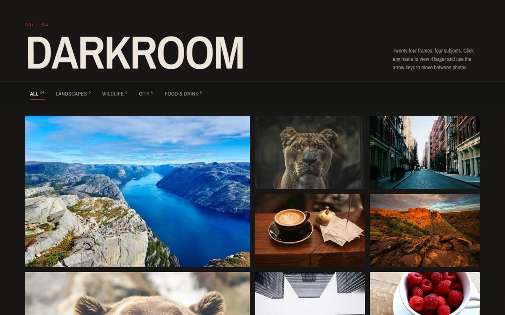

# Darkroom – Image Gallery

My Task 1 for the CodeAlpha Frontend Development internship. The brief was a responsive image gallery with a lightbox, next/prev buttons and hover effects. I also added category filters as the bonus.

I wanted it to feel like a photographer's contact sheet, so it's dark with a red "safelight" accent.



## What it does

- Grid of 24 photos that changes from 4 columns on desktop to 3, 2 and 1 as the screen gets smaller
- Filters for Landscapes, Wildlife, City and Food & Drink. When you switch, the photos slide into place instead of jumping
- Click a photo to open it in a lightbox, with next/prev buttons, a thumbnail strip and the photographer's name
- Slideshow mode
- Keyboard: arrow keys to move, Esc to close, Space for the slideshow
- Swipe left/right on a phone
- Opening a photo updates the URL (like `#photo-433`), so you can share a link to it
- Hover zoom and a caption that slides up. On touch screens the captions just stay visible

## Run it

No install or build step. Open `index.html` in your browser, or use Live Server in VS Code.

## Files

```
index.html
style.css
script.js
images/
  thumbs/   small versions for the grid
  full/     bigger versions for the lightbox
```

## Notes

- The grid loads small thumbnails and the lightbox swaps in the full image after it downloads. The photos next to the current one are preloaded, so flipping through feels quick.
- The filter animation uses the FLIP technique. The script measures where each tile is, changes the layout, measures again, then animates the difference with `transform`. This was the part that took me longest to get right.
- Slide changes use `setTimeout` instead of waiting on animation events, because the lightbox got stuck when I switched tabs mid-animation.

## Next

- Pinch to zoom in the lightbox
- Pull photos from the Unsplash API instead of a fixed list
- Masonry layout

## Credits

Photos are from [Unsplash](https://unsplash.com) via [Lorem Picsum](https://picsum.photos).
